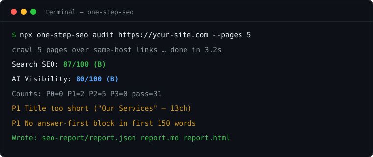
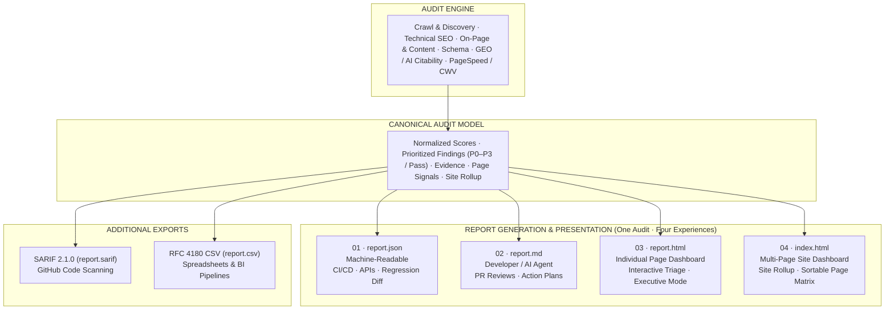

<div align="center">

<p align="center">
  
</p>

# ⚡ One-Step-Seo

**Next-Generation Dual-Engine Auditor & Autonomous Agent Skill Suite for Traditional Search SEO & Generative AI Visibility (GEO / AEO).**

[](https://www.npmjs.com/package/one-step-seo)
[](https://github.com/6t9xstar/one-step-seo/actions/workflows/ci.yml)
[](https://nodejs.org/)
[](package.json)
[](./skills)
[](LICENSE)
[](https://github.com/6t9xstar/one-step-seo/stargazers)
[](CONTRIBUTING.md)

<p align="center">
  <a href="#-one-prompt-for-your-ai-agent-to-do-your-seo-for-you">AI Agent One-Prompt</a> •
  <a href="#-the-modern-search-paradox">Why Dual-Engine?</a> •
  <a href="#-quickstart">Quickstart</a> •
  <a href="#-system-architecture">Architecture</a> •
  <a href="#-the-dual-score-engine">Dual Scoring</a> •
  <a href="#-modular-skills-architecture--agent-skill-library">13 Agent Skills</a> •
  <a href="#-cli-command-suite">CLI Suite</a> •
  <a href="#-cicd-pipeline-integration">CI/CD</a> •
  <a href="#-comparison">Comparison</a>
</p>

---

</div>

`one-step-seo` is a zero-dependency, ultra-fast Node.js CLI and portable **Agent Skill** designed for developers, marketers, and autonomous coding agents. It performs comprehensive technical audits across on-page SEO, schema markup, performance signals, and modern Generative Engine Optimization (GEO/AEO) for AI search engines like **ChatGPT Search, Perplexity AI, Claude, and Google AI Overviews**.

> [!IMPORTANT]
> **Two distinct scores, never blended.** Search engines index technical crawl signals; AI models extract structured facts, direct answers, and citations. `one-step-seo` measures both side-by-side, providing prioritized P0–P3 remediation steps with actionable code snippets.

---

## 🔍 The Modern Search Paradox

```
┌──────────────────────────────────────────────┐    ┌──────────────────────────────────────────────┐
│            Classic Google Search             │    │         AI Search (ChatGPT / Perplexity)     │
├──────────────────────────────────────────────┤    ├──────────────────────────────────────────────┤
│ • Crawlability & Canonical indexation        │    │ • Direct, answer-first opening paragraphs    │
│ • Title tags, Meta descriptions, Clean H1s   │    │ • Extractable data tables, stats, & lists    │
│ • Fast server response & clean robots.txt    │    │ • /llms.txt discovery & AI crawler access    │
│ • Internal anchor texts & XML sitemaps       │    │ • Syntactic entity consistency & FAQ schemas │
└──────────────────────┬───────────────────────┘    └──────────────────────┬───────────────────────┘
                       │                                                   │
                       └───────────────────┬───────────────────────────────┘
                                           │
                                           ▼
         A page can rank #1 on Google yet be completely invisible to AI citation answers,
            or write great content that Google cannot crawl due to broken canonicals.
                       one-step-seo solves both in one command.
```

---

## ⚡ See It in 30 Seconds

```bash
npx one-step-seo quick https://your-site.com
```

<p align="center">
  
</p>

That single command audits technical SEO, on-page structure, content depth, JSON-LD schema, robots/sitemap policies, and AI crawler citability — outputting prioritized fixes right to your console:

```text
Search SEO: 86/100 (B)  |  AI Visibility: 80/100 (B)
Pages audited: 5
Counts: P0=0 P1=1 P2=2 P3=3 pass=39

Top fixes:
  [P1] Thin content (C01-thin) — Expand to fully answer the query; add examples, steps, data.
       Impact: medium · Effort: days · Owner: content
  [P2] llms.txt missing (G01-llms) — Add /llms.txt summarizing key pages for AI crawlers.
       Impact: medium · Effort: minutes · Owner: developer
  [P2] Schema FAQ markup missing (S01-schema) — Add JSON-LD FAQPage markup to earn rich snippets.
       Impact: high · Effort: minutes · Owner: developer

Wrote:
  ./seo-report/report.json   (machine-readable JSON schema)
  ./seo-report/report.md     (citable executive markdown summary)
  ./seo-report/report.html   (shareable standalone responsive dashboard)
```

---

## 🤖 One Prompt for Your AI Agent to Do Your SEO For You

Paste this **single prompt** into **Claude Code, Cursor, Antigravity, Windsurf, Codex, or OpenCode** (replace `https://your-site.com` or `./dist` with your live URL or local build folder) and let your AI coding agent audit, fix, and verify your entire SEO + AI-Search readiness end-to-end:

```text
Act as a Principal Technical SEO & AI-Search (GEO/AEO) Engineer using `one-step-seo`.
Target to audit and optimize: https://your-site.com (and local build/source directory if present in this workspace).

Execute this exact workflow without skipping steps:
1. BASELINE AUDIT:
   - Run: `npx one-step-seo audit https://your-site.com --pages 10 --out ./seo-report --format html,md,json,csv,sarif`
   - Run: `npx one-step-seo ai https://your-site.com --json`
   - Run: `npx one-step-seo llms https://your-site.com`
   - Read `./seo-report/report.json` and `./seo-report/report.md` (and `./seo-report/index.md` for multi-page runs).
   - Report the baseline **Search SEO Score (0–100)** and **AI Visibility Score (0–100)** separately (never blend them), along with P0/P1/P2/P3 counts.

2. SAFE AUTOMATED REMEDIATION (LOCAL FILES):
   - If local HTML or build files exist (e.g., `./dist`, `./out`, `./public`), first preview safe additive `<head>` fixes:
     `npx one-step-seo fix <local-dir> --url https://your-site.com/`
   - Show me the unified diff preview, then apply safe mechanical fixes (`charset`, `viewport`, `lang`, missing `title`/`description`, `canonical`, `og`, `twitter-card`, `favicon`) and verify them in memory.

3. HIGH-IMPACT SOURCE & CONTENT FIXES (P0 -> P1 -> P2):
   - For every remaining P0 and P1 finding in `report.json`, quote the exact `id` and `evidence`, then implement or generate the exact code fix:
     • Technical SEO: fix `noindex` conflicts, broken canonicals, redirect chains, `robots.txt`, and `sitemap.xml`.
     • On-Page & Architecture: fix missing/duplicate `<title>` (30–60 chars) and `<meta name="description">` (120–155 chars), enforce a single `<h1>` aligned with `<title>`, and resolve orphan pages (`0` internal links).
     • Structured Data: run `npx one-step-seo schema https://your-site.com` and add valid JSON-LD `@graph` markup matching visible page content only (never invent ratings, prices, or facts).
     • AI Search & Citability (GEO): draft `/llms.txt` from the `llms` output, allow AI search crawlers (`GPTBot`, `ClaudeBot`, `PerplexityBot`) in `robots.txt` if desired, and structure key pages with a 40–60 word answer-first opening paragraph and semantic `<th>` comparison tables.

4. VERIFICATION & REGRESSION GATE:
   - Re-run the audit to `./seo-report-after` and run:
     `npx one-step-seo diff ./seo-report/report.json ./seo-report-after/report.json --fail-on P1`
   - Present a final before/after scorecard showing Search SEO delta, AI Visibility delta, resolved findings, and where to open `./seo-report-after/report.html` (or `index.html`).
```

---

## 🚀 Quickstart

Run directly with `npx` (no install required) or install globally:

```bash
# Instant beginner-friendly audit (sensible 5-page crawl, all report formats)
npx one-step-seo quick https://example.com

# Interactive wizard: guides you through goals, depths, and opens the HTML report
npx one-step-seo

# Full-site recursive crawl with custom output directory and multi-format reports (HTML, MD, JSON, CSV, SARIF)
npx one-step-seo audit https://example.com --pages 10 --out ./seo-report --format html,md,json,csv

# Deep-dive inspection of a single critical landing or pricing page
npx one-step-seo page https://example.com/pricing

# Inspect JSON-LD schema markup & generate production-ready starter snippets
npx one-step-seo schema https://example.com --generate faq

# Audit XML sitemaps, robots.txt, and canonical loops
npx one-step-seo sitemap https://example.com

# Check llms.txt compliance + generate AI-crawler robots.txt directives
npx one-step-seo llms https://example.com

# Safe auto-fix for local HTML build artifacts (diff preview first, then --apply)
npx one-step-seo fix ./dist/index.html --url https://example.com/

# Regression testing between two audit runs (ideal for PR gates)
npx one-step-seo diff ./seo-report/report-v1.json ./seo-report/report-v2.json --fail-on P0

# System preflight and network sanity check
npx one-step-seo doctor
```

---

## 📐 System Architecture

```
                                  ┌────────────────────────┐
                                  │   npx one-step-seo     │
                                  └───────────┬────────────┘
                                              │
                    ┌─────────────────────────┴─────────────────────────┐
                    ▼                                                   ▼
       ┌─────────────────────────┐                         ┌─────────────────────────┐
       │   Single-Page Auditor   │                         │  Recursive Site Crawler │
       │ (Deep DOM & Signal AST) │                         │ (Polite, Same-Host Only)│
       └────────────┬────────────┘                         └────────────┬────────────┘
                    │                                                   │
                    └─────────────────────────┬─────────────────────────┘
                                              │
                                              ▼
                    ┌───────────────────────────────────────────────────┐
                    │            Signal Evaluation Pipeline             │
                    │ • Technical: HTTPS, Status, Canonical, Robots     │
                    │ • On-Page: Title, Meta, H1 Hierarchy, Anchors     │
                    │ • Content: Word Counts, Paragraph Flow, Thinness  │
                    │ • Schema: JSON-LD Extraction & Graph Validation   │
                    │ • GEO/AEO: Answer-first, Tables, Facts, llms.txt  │
                    └─────────────────────────┬─────────────────────────┘
                                              │
                      ┌───────────────────────┴───────────────────────┐
                      ▼                                               ▼
         ┌─────────────────────────┐                     ┌─────────────────────────┐
         │     Search SEO Engine   │                     │    AI Visibility Engine │
         │ (100 - Penalty Model)   │                     │  (Additive 100 Checklist│
         └────────────┬────────────┘                     └────────────┬────────────┘
                      │                                               │
                      └───────────────────────┬───────────────────────┘
                                              │
                                              ▼
                    ┌───────────────────────────────────────────────────┐
                    │               Multi-Format Reporting              │
                    │ • report.json (Automated tooling & CI gates)      │
                    │ • report.md   (Human PR reviews & Agent action)   │
                    │ • report.html (Interactive page dashboard)        │
                    │ • index.html  (Aggregated multi-page site rollup) │
                    │ • SARIF / CSV (GitHub Code Scanning & BI exports) │
                    └───────────────────────────────────────────────────┘
```

### Reporting Architecture — One Audit, Four Experiences

Every audit runs once through the core deterministic engine and normalizes into a single canonical audit model (`lib/schema-report.json`), powering four primary output experiences plus two enterprise export adapters:



| Experience                   | Output File    | Target Audience               | Key Capabilities                                                                                                                               |
| :--------------------------- | :------------- | :---------------------------- | :--------------------------------------------------------------------------------------------------------------------------------------------- |
| **01 · Machine-Readable**    | `report.json`  | CI/CD, APIs, Regression Gates | Draft-07 schema validated (`lib/schema-report.json`), version-stamped (`rulesVersion`), deterministic diffing (`one-step-seo diff`).           |
| **02 · Developer / Agent**   | `report.md`    | Engineers, PR Reviews, LLMs   | Verdict-first executive summary, page & AI signal snapshot, Impact/Effort/Owner triage, copy-paste code fixes, verification commands.          |
| **03 · Individual Page UI**  | `report.html`  | Developers, SEO Leads, Execs  | Self-contained zero-dependency dashboard with Dark/Light/Auto theme toggle, Executive Mode, interactive findings explorer, and CWV cards.      |
| **04 · Multi-Page Site UI**  | `index.html`   | Site Owners, Technical SEOs   | Site-wide executive rollup, valid-page score aggregation, sortable/filterable page matrix, recurring issues, duplicate metadata, orphan risks. |
| **Adapter · Code Scanning**  | `report.sarif` | GitHub Security Tab           | Official OASIS SARIF v2.1.0 schema compliance (`--format sarif`) for inline pull-request annotations.                                          |
| **Adapter · Tabular Export** | `report.csv`   | Analysts, BI & Spreadsheets   | RFC 4180 CSV (`--format csv`) hardened against CWE-1236 spreadsheet formula injection.                                                         |

> [!NOTE]
> **Authoritative Runtime Source:** `lib/report.mjs` (`renderHtml()` and `renderSiteIndex()`) is the single authoritative runtime HTML generator so the CLI stays zero-dependency with no template loader. `templates/report.html` is maintained strictly as a design-system reference document.

---

## 📊 The Dual-Score Engine

`one-step-seo` refuses to blend search crawlability with AI citability. They are calculated using different mathematical models grounded in actual web platform behavior:

```
┌────────────────────────────────────────────────────────────────────────────────────────┐
│  Search SEO Score (0–100, A–F)          │  AI Visibility Score (0–100, A–F)            │
├─────────────────────────────────────────┼──────────────────────────────────────────────┤
│ Model: Deductive Penalty Architecture   │ Model: Weighted Citability Checklist         │
│ Starts at 100 and deducts by severity:  │ Evaluates 9 direct citability criteria:      │
│ • P0 (Critical blocker): -25 pts        │ • Answer-first opening paragraph:  +25 pts   │
│ • P1 (High-impact issue): -10 pts       │ • Structured tables & clean lists: +20 pts   │
│ • P2 (Medium opportunity): -3 pts       │ • Substantive content (≥300 words): +15 pts  │
│ • P3 (Low-level polish):   -1 pt        │ • Direct FAQ question & answers:   +10 pts   │
│                                         │ • Clean, singular H1 heading:      +10 pts   │
│ Measures: Crawlability, indexability,   │ • Descriptive H2 topic breakdowns: +5 pts    │
│ canonical consistency, valid titles,    │ • Valid title & meta description:  +5 pts    │
│ internal link integrity, and schemas.   │ • Accessible /llms.txt directory:  +5 pts    │
│                                         │ • AI crawler tokens allowed:       +5 pts    │
└─────────────────────────────────────────┴──────────────────────────────────────────────┘
```

### Grade Bands

| Grade | Score Band | Meaning                                                                                   |
| :---: | :--------: | :---------------------------------------------------------------------------------------- |
| **A** | `90 – 100` | **Excellent**: Best practices fulfilled; maximum crawlability and quotation potential.    |
| **B** | `80 – 89`  | **Good**: Solid technical foundation; minor content expansion or schema opportunities.    |
| **C** | `70 – 79`  | **Fair**: Moderate indexing blockers or missing AI citability signals.                    |
| **D** | `60 – 69`  | **Poor**: Substantial technical defects, thin content, or blocked crawler directives.     |
| **F** |   `< 60`   | **Critical**: Severe P0 indexing failures, broken canonical loops, or missing foundation. |

---

## 🛠️ CLI Command Suite

| Command                  | Purpose                                                       | Primary Flags                                                                                                    |
| :----------------------- | :------------------------------------------------------------ | :--------------------------------------------------------------------------------------------------------------- |
| `quick <url\|dir>`       | Fastest way to audit a site or local build directory.         | `--pages`, `--out`, `--quiet`                                                                                    |
| `audit <url\|dir>`       | Comprehensive multi-page crawl or local directory audit.      | `--pages`, `--crawl`, `--profile`, `--psi`, `--fail-on`, `--format`, `--skills`, `--exclude-skills`, `--offline` |
| `page <url\|file>`       | Deep dive on a single page or offline HTML file.              | `--out`, `--format`, `--psi`, `--skills`, `--exclude-skills`, `--offline`, `--block-private-ips`                 |
| `ai <url>`               | Dedicated AI Search Visibility and Citability audit.          | `--out`, `--format`, `--json`, `--skills`, `--exclude-skills`, `--block-private-ips`                             |
| `skills [id]`            | Inspect modular auditing skills catalog and check rules.      | `--json`                                                                                                         |
| `schema <url>`           | Validate JSON-LD and print copy-paste schema snippets.        | `--generate (video\|job\|course\|review\|recipe\|...)`                                                           |
| `sitemap <url>`          | Audit sitemap index, robots.txt, and link seeds.              | `--json`, `--block-private-ips`                                                                                  |
| `llms <url>`             | Audit `/llms.txt` and generate AI crawler `robots.txt` rules. | `--json`, `--block-private-ips`                                                                                  |
| `fix <file\|dir>`        | Safe, dry-run diff patcher for local HTML files.              | `--apply`, `--url`, `--no-backup`                                                                                |
| `diff <a.json> <b.json>` | Detect score drops and finding escalations between builds.    | `--fail-on (P0\|P1)`                                                                                             |
| `doctor`                 | Verify environment, runtime config, and connectivity.         | `--json`, `--check-config`                                                                                       |

---

## 🧠 Modular Skills Architecture & Agent Skill Library

`one-step-seo` separates **14 programmatic CLI skill groups** (`lib/skills.mjs`, used by `--skills`, `--exclude-skills`, and `one-step-seo skills`) from **13 specialized Agent Skill playbooks** (`skills/*/SKILL.md`, markdown workflow specifications for AI coding agents) across 7 core engineering and editorial domains:

```bash
# List all 14 CLI skills with categories, offline support, check counts, and agent playbooks
npx one-step-seo skills

# Inspect detailed checks, aliases, remediation guidelines, and limitations for a skill
npx one-step-seo skills onpage-optimization
npx one-step-seo skills geo-optimization --json
```

### Skill Library Matrix

| Category                   | Skill Name (`--skills`)                                     | Purpose                                                                                                         | CLI Support                                       | External Data Requirements                            | Skill Documentation Link                                                                                                                                       |
| :------------------------- | :---------------------------------------------------------- | :-------------------------------------------------------------------------------------------------------------- | :------------------------------------------------ | :---------------------------------------------------- | :------------------------------------------------------------------------------------------------------------------------------------------------------------- |
| **Core Workflow**          | `seo-audit`                                                 | Full-spectrum audit execution, dual-score interpretation, and prioritized remediation                           | `audit`, `page`, `quick`, `ai`                    | None (100% local/live HTML; optional `--psi` / GSC)   | [`skills/seo-audit/SKILL.md`](./skills/seo-audit/SKILL.md)                                                                                                     |
| **Core Workflow**          | `seo-fix`                                                   | Conservative, dry-run-first automated HTML remediation with in-memory verification                              | `fix [--apply]`                                   | None (100% local HTML files/directories)              | [`skills/seo-fix/SKILL.md`](./skills/seo-fix/SKILL.md)                                                                                                         |
| **Technical SEO**          | `technical-seo`                                             | Crawlability, indexation (`noindex`), canonical URLs, redirect chains, HTTPS/status                             | `audit/page --skills technical-seo`               | Live HTTP required for status, redirects, and headers | [`skills/technical-seo/SKILL.md`](./skills/technical-seo/SKILL.md)                                                                                             |
| **Technical SEO**          | `sitemap-robots`                                            | `robots.txt` directives, XML sitemap discovery, `<sitemapindex>` validation                                     | `sitemap`, `audit --skills sitemap-robots`        | Live origin or local build `robots.txt`/`sitemap.xml` | [`skills/sitemap-robots/SKILL.md`](./skills/sitemap-robots/SKILL.md)                                                                                           |
| **On-Page & Content**      | `onpage-optimization` (`onpage-seo`)                        | `<title>`, meta description, H1–H6 hierarchy, Open Graph, Twitter Card, image alt/CLS                           | `audit/page --skills onpage-optimization`         | None (100% offline + live HTML compatible)            | [`skills/onpage-optimization/SKILL.md`](./skills/onpage-optimization/SKILL.md)                                                                                 |
| **On-Page & Content**      | `content-quality` (`content-architecture`)                  | Word count depth, answer-first lead blocks, comparison tables (`<th>`), FAQ structure                           | `audit/page --skills content-quality`             | None (100% offline + live HTML compatible)            | [`skills/content-quality/SKILL.md`](./skills/content-quality/SKILL.md)                                                                                         |
| **On-Page & Content**      | `duplicate-content`                                         | Cross-page duplicate `<title>` and meta descriptions, canonical consolidation                                   | `audit --pages N --skills duplicate-content`      | Requires multi-page crawl (`--pages 2+`)              | [`skills/duplicate-content/SKILL.md`](./skills/duplicate-content/SKILL.md)                                                                                     |
| **On-Page & Content**      | `internal-linking`                                          | Internal link density, orphan/dead-end page detection, generic anchor text, 4xx links                           | `audit --skills internal-linking [--check-links]` | Live HTTP required for `--check-links` status probes  | [`skills/internal-linking/SKILL.md`](./skills/internal-linking/SKILL.md)                                                                                       |
| **GEO / AEO / AI Search**  | `geo-optimization` (`geo-ai-search`)                        | AI crawler access (`GPTBot`, `ClaudeBot`, `PerplexityBot`), snippet gates, citability                           | `ai`, `audit --skills geo-optimization`           | None (100% offline + live HTML compatible)            | [`skills/geo-optimization/SKILL.md`](./skills/geo-optimization/SKILL.md)                                                                                       |
| **GEO / AEO / AI Search**  | `llms-txt`                                                  | `/llms.txt` discovery, structural quality (`G05`), starter generation & bot policies                            | `llms`, `audit --skills llms-txt`                 | Live origin or local build `llms.txt`                 | [`skills/llms-txt/SKILL.md`](./skills/llms-txt/SKILL.md)                                                                                                       |
| **Structured Data**        | `schema-validation` (`structured-data`)                     | JSON-LD syntax, `@graph` entity linking, 15 required-property validator rules (17 Schema.org types), FAQ parity | `schema`, `audit --skills schema-validation`      | None (100% offline + live HTML compatible)            | [`skills/schema-validation/SKILL.md`](./skills/schema-validation/SKILL.md)                                                                                     |
| **Performance & Quality**  | `core-web-vitals` (`performance-cwv`)                       | HTML payload size, image count, Lighthouse lab metrics (LCP/CLS/TBT) & CrUX field INP                           | `audit/page --psi --skills core-web-vitals`       | `PSI_API_KEY` env var for live `--psi` lab/CrUX data  | [`skills/core-web-vitals/SKILL.md`](./skills/core-web-vitals/SKILL.md)                                                                                         |
| **Monitoring & Reporting** | `seo-regression`                                            | Baseline vs. candidate JSON diffing, score deltas, `rulesVersion` parity, CI gates                              | `diff <base.json> <head.json> [--fail-on P0\|P1]` | Two `report.json` artifacts (zero network needed)     | [`skills/seo-regression/SKILL.md`](./skills/seo-regression/SKILL.md)                                                                                           |
| **Additional CLI Skills**  | `security-hygiene`, `accessibility-ux`, `international-seo` | Mixed content (`T13`), security headers (`T15`), third-party scripts (`T14`), `hreflang` (`W03`)                | `audit/page --skills security,a11y,i18n`          | Live HTTP required for `T15-security-headers`         | Covered in [`skills/technical-seo/SKILL.md`](./skills/technical-seo/SKILL.md) & [`skills/onpage-optimization/SKILL.md`](./skills/onpage-optimization/SKILL.md) |

### Selective Skill Execution (`--skills` & `--exclude-skills`)

Run audits targeted to specific engineering or editorial disciplines (supports primary IDs, category names, and aliases):

```bash
# Focus only on On-Page and Structured Data skills
npx one-step-seo audit https://example.com --skills onpage-optimization,schema-validation

# Focus on Sitemap & Robots or Internal Linking
npx one-step-seo audit https://example.com --skills sitemap-robots,internal-linking

# Run full audit but skip performance checks (e.g. in environments without PSI API keys)
npx one-step-seo audit https://example.com --exclude-skills core-web-vitals
```

---

## 🔌 100% Offline Auditing Engine

Audit local static site builds (Astro, Next.js static exports, Vite, Hugo, raw HTML) completely offline without deploying or running a web server:

```bash
# Audit a single local HTML file
npx one-step-seo page ./dist/index.html --out ./offline-report

# Audit an entire build directory offline (recursively audits up to N HTML files)
npx one-step-seo audit ./dist --pages 10 --out ./offline-report

# Enforce pure offline execution (skips all remote network requests)
npx one-step-seo audit ./dist --offline
```

- **Local Asset Discovery**: Automatically inspects `robots.txt`, `sitemap.xml`, and `llms.txt` if present in the build directory.
- **Zero Network Leakage**: Never triggers external network calls when auditing local files.
- **Full Reporting**: Generates interactive HTML dashboards, executive Markdown summaries, RFC 4180 CSV, and GitHub SARIF reports directly on disk.

---

## ⚡ Core Web Vitals & PageSpeed Insights (`--psi`)

Evaluate real lab performance and Chrome UX Report (CrUX) field data alongside traditional SEO and AI visibility:

```bash
# Set your API key in the environment (never committed or leaked)
export PSI_API_KEY="your_google_cloud_api_key"

# Audit a single page with mobile Core Web Vitals
npx one-step-seo page https://example.com --psi

# Audit multi-page crawl with desktop strategy
npx one-step-seo audit https://example.com --pages 5 --psi --psi-strategy desktop
```

- **Lab metrics**: Largest Contentful Paint (LCP), Cumulative Layout Shift (CLS), Total Blocking Time (TBT), First Contentful Paint (FCP), Speed Index, Time to First Byte (TTFB).
- **Field metrics**: Real-user 75th-percentile data directly from the Chrome UX Report (CrUX).
- **Security by design**: The key is read exclusively from `process.env.PSI_API_KEY`, never passed as a CLI flag or recorded in reports.

---

## 📑 Rule Catalogue (45+ Audited Signals)

<details>
<summary><b>Click to expand full audit rules breakdown (Technical, On-Page, Content, Schema, GEO, Performance)</b></summary>
<br>

### 🌐 Technical SEO (`T00` – `T17`)

- `T00-truncated`: Flags HTML payloads over 5 MiB that were truncated to head-only inspection.
- `T01-https`: Enforces HTTPS protocol; flags insecure HTTP final URLs.
- `T02-status`: Verifies HTTP 200 OK status; alerts on 4xx/5xx errors or invalid final URLs.
- `T03-redirects`: Flags redirect chains (`>1` hop) and redirect loops.
- `T04-content-type`: Verifies document is served as `text/html`.
- `T05-robots` / `T05-robots-disallow`: Checks `robots.txt` availability and alerts if the audited path is disallowed.
- `T06-sitemap`: Verifies XML sitemap availability (`sitemap.xml` or `Sitemap:` directives in `robots.txt`).
- `T07-noindex`: Detects `noindex` directives in `<meta name="robots">` or `X-Robots-Tag` headers.
- `T08-canonical`: Validates `<link rel="canonical">` presence (`P2` when missing) and self-reference (`P1` on mismatch).
- `T09-lang`: Verifies `<html lang="...">` declaration.
- `T10-charset`: Verifies UTF-8 character encoding declaration.
- `T11-viewport`: Validates mobile-friendly `<meta name="viewport">` configuration.
- `T12-url`: Flags parameterized query-string URLs on short content paths.
- `T13-mixed`: Detects active (`P1`) or passive (`P2`) mixed-content `http://` subresources on `https://` pages.
- `T14-third-party`: Tracks excessive third-party script origins (`>5` external script hosts).
- `T15-security-headers`: Checks for recommended HTTP security headers (`Content-Security-Policy`, `Strict-Transport-Security`, `X-Content-Type-Options`).
- `T16-broken-links`: Opt-in (`--check-links`) probe flagging same-host links that return 4xx/5xx or fail.
- `T17-canonical-http`: Flags canonical tags specifying insecure `http://` on an `https://` page.

### 📄 On-Page & Polish Signals (`O01` – `O11`, `W01` – `W03`)

- `O01-title`: Validates `<title>` presence (`P0` when missing) and optimal length (30–60 characters).
- `O02-meta`: Validates `<meta name="description">` presence (`P1` when missing) and length (120–155 characters).
- `O03-h1` / `O03-h1-drift`: Enforces a single descriptive `<h1>` (`P1`) and checks lexical alignment with `<title>` (`P3`).
- `O04-headings` / `O04-heading-empty`: Flags skipped heading levels (`<h1>` → `<h3>`) and empty heading elements (`<h1>`–`<h6>`).
- `O05-h2`: Verifies descriptive `<h2>` subheadings on articles over 600 words.
- `O06-og`: Checks Open Graph metadata completeness (`og:title`, `og:description`, `og:image`).
- `O07-favicon`: Verifies `<link rel="icon">` declaration.
- `O08-img-alt`: Identifies images missing `alt` attributes (`P1` when all missing, `P2` when partial).
- `O09-img-dims`: Flags `` tags missing explicit `width`/`height` attributes (CLS prevention).
- `O10-internal` / `O10-internal-many`: Flags dead-end pages with `0` internal links (`P1`) or excessive internal links (`>200`, `P2`).
- `O11-generic-anchors`: Flags repetitive generic anchor text (`click here`, `read more`, `learn more`).
- `W01-social` / `W02-og-url` / `W03-hreflang`: Validates `twitter:card`, `og:url` canonical parity, and `hreflang` self/x-default completeness (`P3`).

### ✍️ Content Quality (`C01` – `C05`)

- `C01-thin`: Identifies thin content under profile word-count thresholds (`200` words default/blog/docs, `100` product, `80` home).
- `C02-answer`: Verifies an answer-first summary or definition in the opening 150 words.
- `C03-structures`: Checks for extractable `<ul>`/`<ol>` lists or `<table>` blocks on substantive pages.
- `C04-faq`: Checks for visible FAQ question-and-answer coverage or `FAQPage` schema.
- `C05-table-headers`: Flags `<table>` elements missing semantic `<th>` header cells (`P3`).

### 🧬 Structured Data & Schema (`S01` – `S03`)

- `S01-present` / `S01-jsonld-parse`: Verifies JSON-LD presence and valid JSON syntax (`P1` on parse error).
- `S02-<type>` / `S02-unknown-type`: Enforces 15 required-property validator rules covering 17 Schema.org types (`Article`/`NewsArticle`/`BlogPosting`, `FAQPage`, `BreadcrumbList`, `Product`, `Event`, `VideoObject`, `Organization`, `LocalBusiness`, `WebSite`, `HowTo`, `JobPosting`, `Course`, `Recipe`, `Review`, `SoftwareApplication`).
- `S03-faq-parity`: Verifies that `FAQPage` JSON-LD and visible FAQ headings stay synchronized (`P3`).

### 🤖 Generative AI & Citability (`G01` – `G11`)

- `G01-llms`: Detects presence and accessibility of `/llms.txt`.
- `G02-ai-blocked`: Checks if AI crawlers (`GPTBot`, `ClaudeBot`, `PerplexityBot`, `Google-Extended`, etc.) are blocked in `robots.txt`.
- `G03-facts`: Evaluates extractable tables, lists, and FAQ structures for AI citation extraction.
- `G04-entity`: Inspects entity consistency between `<title>` and `og:title` (`P3`).
- `G05-llms-quality`: Validates markdown headings and links inside `/llms.txt` (`P3`).
- `G06-freshness`: Detects timestamp markers (`dateModified`, `datePublished`, `<time datetime>`) for AI freshness (`P3`).
- `G07-question-headings`: Checks for question-shaped `<h2>` headings matching natural-language prompts (`P3`).
- `G08-stat-density`: Evaluates presence of quantified metrics with units on substantive pages (`P3`).
- `G09-snippet-controls`: Alerts on `nosnippet` or restrictive `max-snippet` directives that block AI quoting (`P2`).
- `G10-author`: Checks for author or publisher attribution on substantive 300+ word pages (`P3`).
- `G11-semantic-content`: Checks for `<main>` or `<article>` landmarks on 600+ word pages (`P3`).

### ⚡ Performance & Core Web Vitals (`P01` – `P05`)

- `P01-html-size`: Flags HTML payloads exceeding 300 KB (`P2`).
- `P02-img-count`: Flags pages with more than 20 `` elements (`P2`).
- `P03-psi-lab` / `P04-psi-field` / `P05-psi-error`: Opt-in (`--psi`) Google PageSpeed Insights lab metrics (LCP, CLS, TBT) and CrUX 75th-percentile field metrics (LCP, CLS, INP).

</details>

---

## 🎯 Audit Profiles

Calibrate scoring thresholds and checks to suit your specific website architecture (`default`, `blog`, `product`, `docs`, `home`):

```bash
# Product / E-commerce: Adjusted word-count thresholds (100 words) for product and landing pages
npx one-step-seo audit https://shop.example.com --profile product

# Documentation: Emphasizes technical reference structure, H2/H3 hierarchies, and llms.txt integration
npx one-step-seo audit https://docs.example.com --profile docs

# Editorial / Blog: Enforces full 200-word depth, answer-first lead blocks, and author/freshness signals
npx one-step-seo audit https://blog.example.com --profile blog

# Homepage: Calibrated for concise navigation-focused homepages (80-word threshold, skips H2/FAQ penalties)
npx one-step-seo page https://example.com --profile home
```

---

## 🤖 Autonomous AI Agents (`SKILL.md` + 13 Specialized Sub-Skills)

`one-step-seo` ships with a root **Agent Skill** (`SKILL.md`) plus **13 domain-specialized sub-skills** (`skills/*/SKILL.md`) compatible with **Claude Code, Cursor, Antigravity, Windsurf, Codex, OpenCode**, and custom LLM agent workstreams:

```bash
# Install root skill + all 13 specialized sub-skills for Claude Code / Antigravity / Cursor
git clone --depth 1 https://github.com/6t9xstar/one-step-seo.git
mkdir -p ~/.claude/skills/one-step-seo
cp one-step-seo/SKILL.md ~/.claude/skills/one-step-seo/SKILL.md
cp -r one-step-seo/skills/* ~/.claude/skills/
```

### Ready-to-Use AI Agent Prompts by Domain

| Goal                             | Copy-Paste Prompt for Your AI Agent                                                                                                                                                   |
| :------------------------------- | :------------------------------------------------------------------------------------------------------------------------------------------------------------------------------------ |
| **Full SEO + AI Autopilot**      | _"Run `npx one-step-seo audit https://my-saas.com --pages 10 --out ./seo-report`, read `report.json`, fix all P0/P1 issues, draft `/llms.txt`, and verify the score improvement."_    |
| **Offline Local Build Fixer**    | _"Audit our build directory with `npx one-step-seo audit ./dist --offline`, preview safe HTML fixes with `npx one-step-seo fix ./dist --url https://my-saas.com/`, and apply them."_  |
| **AI Search & Citability (GEO)** | _"Run `npx one-step-seo ai https://my-saas.com` and `npx one-step-seo llms https://my-saas.com`, then optimize our pages for ChatGPT/Perplexity citations and generate `/llms.txt`."_ |
| **JSON-LD `@graph` Schema**      | _"Run `npx one-step-seo schema https://my-saas.com`, validate all JSON-LD blocks, and generate a unified `@graph` (`Organization` + `WebSite` + `FAQPage`) matching visible copy."_   |
| **PR Regression Check**          | _"Compare our baseline and PR build with `npx one-step-seo diff base-report.json pr-report.json --fail-on P1` and summarize any new or escalated SEO findings."_                      |

Each skill follows a strict 9-section engineering contract instructing agents to:

1. Parse the schema-validated `report.json` output and quote verbatim `evidence`.
2. Prioritize P0 (critical) and P1 (high-impact) findings first with Impact / Effort / Owner labels.
3. Apply conservative, additive fixes via `one-step-seo fix` with dry-run diff previews and `.bak` backups.
4. Keep Search SEO and AI Visibility scores separate in executive reports and never fabricate facts, reviews, or metrics.

---

## 🔄 CI/CD Pipeline Integration

Gate pull requests and automatically prevent SEO or AI-visibility regressions with GitHub Actions:

```yaml
name: SEO & AI Visibility CI Gate

on:
  pull_request:
    branches: [main]

jobs:
  seo-audit:
    name: Audit Pull Request
    runs-on: ubuntu-latest
    steps:
      - name: Checkout Code
        uses: actions/checkout@v4

      - name: Set up Node.js
        uses: actions/setup-node@v4
        with:
          node-version: "20"

      # Fail the job if any P0 (critical blocker) is detected
      - name: Run SEO & GEO Audit
        run: |
          npx one-step-seo audit https://staging.example.com \
            --pages 5 \
            --out ./seo-report \
            --fail-on P0

      # Upload HTML and Markdown reports as job artifacts
      - name: Upload SEO Reports
        uses: actions/upload-artifact@v4
        if: always()
        with:
          name: seo-report
          path: ./seo-report/
```

---

<span id="-comparison"></span><span id="comparison"></span>

## 🏆 Modern SEO & AI Tooling Comparison

How `one-step-seo` compares to legacy desktop crawlers, browser-based performance runners, enterprise SaaS suites, and ad-hoc LLM scripts:

### Feature & Capability Matrix

| Capability                        |             `one-step-seo`              |      Google Lighthouse      |       Screaming Frog        |    Cloud SaaS (Ahrefs / Semrush)    |   Custom LLM / Browser Scripts    |
| :-------------------------------- | :-------------------------------------: | :-------------------------: | :-------------------------: | :---------------------------------: | :-------------------------------: |
| **Execution**                     |      `npx one-step-seo` (Instant)       |    Chrome DevTools / CLI    |      Desktop Java App       |        Web Dashboard (Cloud)        |       Python / Node Script        |
| **Runtime Dependencies**          |         **0 (Node 18+ stdlib)**         | Chromium Headless (~400MB)  |    Java Runtime (~500MB)    |         N/A (Remote Cloud)          |  Heavy (Playwright / Puppeteer)   |
| **Offline / Local Auditing**      |        ✅ **100% Offline-First**        | ⚠️ Local (requires browser) |      ✅ Local Desktop       |     ❌ Cloud only (Public URLs)     | ⚠️ Requires local browser engine  |
| **Search SEO Engine**             |    ✅ **Deductive Penalty (0–100)**     | ⚠️ Basic 10-point checklist |  ❌ Raw unweighted tables   |        ✅ Cloud health score        |    ❌ Subjective chat response    |
| **AI Visibility (GEO / AEO)**     |     ✅ **Dedicated 9-signal score**     |           ❌ None           |           ❌ None           |               ❌ None               | ⚠️ Uncalibrated unstructured text |
| **`/llms.txt` Audit & Generator** |       ✅ **Built-in CLI command**       |           ❌ None           |           ❌ None           |               ❌ None               |     ⚠️ Manual prompt required     |
| **AI Bot Governance Checks**      |     ✅ **GPTBot, ClaudeBot, etc.**      |           ❌ None           |   ⚠️ Raw robots.txt lines   |       ⚠️ Basic crawler rules        |              ❌ None              |
| **Automated HTML Fixer**          |    ✅ **Dry-run diff & safe patch**     |     ❌ Read-only audit      |     ❌ Read-only export     |    ❌ Read-only recommendations     |   ⚠️ Hallucination-prone edits    |
| **CI/CD Regression Tracking**     |       ✅ **`diff` + `--fail-on`**       |    ⚠️ LHCI (heavy setup)    |      ❌ Manual diffing      |       ❌ Slow cloud crawling        |    ❌ Custom fragile glue code    |
| **GitHub Code Scanning**          |       ✅ **Native SARIF v2.1.0**        |     ❌ JSON / HTML only     |     ❌ CSV / Excel only     |     ❌ Third-party integrations     |      ❌ Custom parser needed      |
| **Multi-Format Export**           | ✅ **HTML, Markdown, JSON, SARIF, CSV** |     ⚠️ HTML / JSON only     |     ⚠️ CSV / Excel only     |         ⚠️ PDF / CSV export         |        ❌ Raw output only         |
| **SSRF & Metadata Protection**    |  ✅ **Cloud metadata & RFC1918 safe**   |    ⚠️ Generic HTTP agent    |  ⚠️ Standard network stack  |       ❌ Remote cloud crawler       |      ❌ Unvalidated request       |
| **Core Web Vitals Integration**   |    ✅ **PageSpeed & CrUX (`--psi`)**    |   ✅ Lab metrics built-in   |     ⚠️ API key required     |     ⚠️ Periodic CrUX snapshots      |              ❌ None              |
| **AI Agent Integration**          |    ✅ **Native `SKILL.md` included**    |    ❌ Manual CLI wrapper    | ❌ No native agent protocol |           ❌ Web UI only            |     ⚠️ Custom setup required      |
| **Privacy & Telemetry**           |    🔒 **Zero telemetry, 100% local**    |     ⚠️ Google telemetry     |    ⚠️ License validation    | ❌ Complete site data sent to cloud |             ⚠️ Varies             |
| **Cost & Licensing**              |         **Free (MIT License)**          |      Free (Apache 2.0)      |    $259 / year / license    |       $1,200 – $6,000+ / year       |     Varies / API token costs      |

---

### ⚡ Performance & Footprint Benchmark

Tested against standard modern production page audits:

| Metric                        |     `one-step-seo`      |     Google Lighthouse     |        Screaming Frog        | Custom Playwright Script  |
| :---------------------------- | :---------------------: | :-----------------------: | :--------------------------: | :-----------------------: |
| **Startup Latency**           |      **< 150 ms**       |     2,500 – 4,500 ms      |      6,000 – 12,000 ms       |     3,000 – 6,000 ms      |
| **RAM Footprint (1 page)**    |     **~35 – 55 MB**     |       450 – 850 MB        |        800 – 2,000 MB        |       500 – 950 MB        |
| **Engine Footprint**          | **0 MB (Zero install)** | ~380 MB (Chromium binary) |  ~600 MB (Java + binaries)   | ~400 MB (Browser drivers) |
| **Audit Speed (Single Page)** |    **~200 – 400 ms**    |     4,000 – 8,000 ms      |       1,500 – 3,000 ms       |     3,500 – 7,000 ms      |
| **CI/CD Pipeline Impact**     | **Near-zero overhead**  |  +45–90s container boot   | Not practical in headless CI |  +30–60s driver download  |

---

### 💡 Why Developers & Agents Choose `one-step-seo`

```
┌─────────────────────────────────────────────────────────────────────────────────────────────────┐
│                                  THE ONE-STEP-SEO ADVANTAGE                                     │
├────────────────────────────────┬────────────────────────────────┬───────────────────────────────┤
│ 🚀 Zero-Dependency Speed       │ 🧠 The Dual-Engine Paradigm    │ 🛠️ Safe Local Auto-Fixer      │
│ Runs instantly with `npx`. No  │ Classic search engines index   │ Don't just detect defects —   │
│ Chrome download, no Python     │ crawl signals; AI assistants   │ patch them. Includes in-memory│
│ venv, no Java runtime, and zero│ extract structured answers.    │ verification, dry-run diffs,  │
│ telemetry. 100% portable.      │ Measure both side-by-side.     │ and automatic `.bak` backups. │
├────────────────────────────────┼────────────────────────────────┼───────────────────────────────┤
│ 🛡️ Native CI/CD & SARIF Gating │ ⚡ Integrated Core Web Vitals   │ 🤖 Autonomous Agent Ready     │
│ Fail PRs on P0/P1 breaches.    │ Lab diagnostics + Chrome UX    │ Features a native `SKILL.md`  │
│ Export industry-standard SARIF │ Report (CrUX) field data via   │ allowing Claude Code, Cursor, │
│ for native GitHub annotations. │ `--psi` without browser bloat. │ and OpenCode to self-remediate│
└────────────────────────────────┴────────────────────────────────┴───────────────────────────────┘
```

---

## 🔒 Privacy & Data Ethics

- **Zero Telemetry**: No analytics, no tracking pixels, no telemetry beacons.
- **100% Local Reports**: Reports stay on your local disk (`--out`) and are never sent to external servers.
- **Polite Crawler**: Enforces same-host restrictions, respects `robots.txt` by default, uses controlled delays between page fetches, and identifies itself clearly with a standard `User-Agent`.

---

## 📚 Documentation Index

- [Command-Line Reference & Flags (`docs/USAGE.md`)](./docs/USAGE.md)
- [Complete Check Definitions (`docs/CHECKS.md`)](./docs/CHECKS.md)
- [Scoring Formula & Mathematics (`docs/SCORING.md`)](./docs/SCORING.md)
- [GitHub Actions & CI Setup Recipes (`docs/CI.md`)](./docs/CI.md)
- [Frequently Asked Questions (`docs/FAQ.md`)](./docs/FAQ.md)
- [Troubleshooting Common Issues (`docs/TROUBLESHOOTING.md`)](./docs/TROUBLESHOOTING.md)
- [Project Roadmap (`docs/ROADMAP.md`)](./docs/ROADMAP.md)

---

## 🤝 Contributing

Contributions are welcome! Please read [CONTRIBUTING.md](./CONTRIBUTING.md) and adhere to our [Code of Conduct](./CODE_OF_CONDUCT.md).

```bash
git clone https://github.com/6t9xstar/one-step-seo.git
cd one-step-seo
npm install
npm run check
```

---

## 📄 License

Distributed under the **MIT License**. See [LICENSE](./LICENSE) for details.

<div align="center">

<p align="center">
  <a href="https://www.star-history.com/#6t9xstar/one-step-seo&Date"></a>
</p>

**If one-step-seo improved your rankings or AI visibility, please consider starring the repository! ⭐**  
Maintained by [6t9xstar](https://github.com/6t9xstar).

</div>
